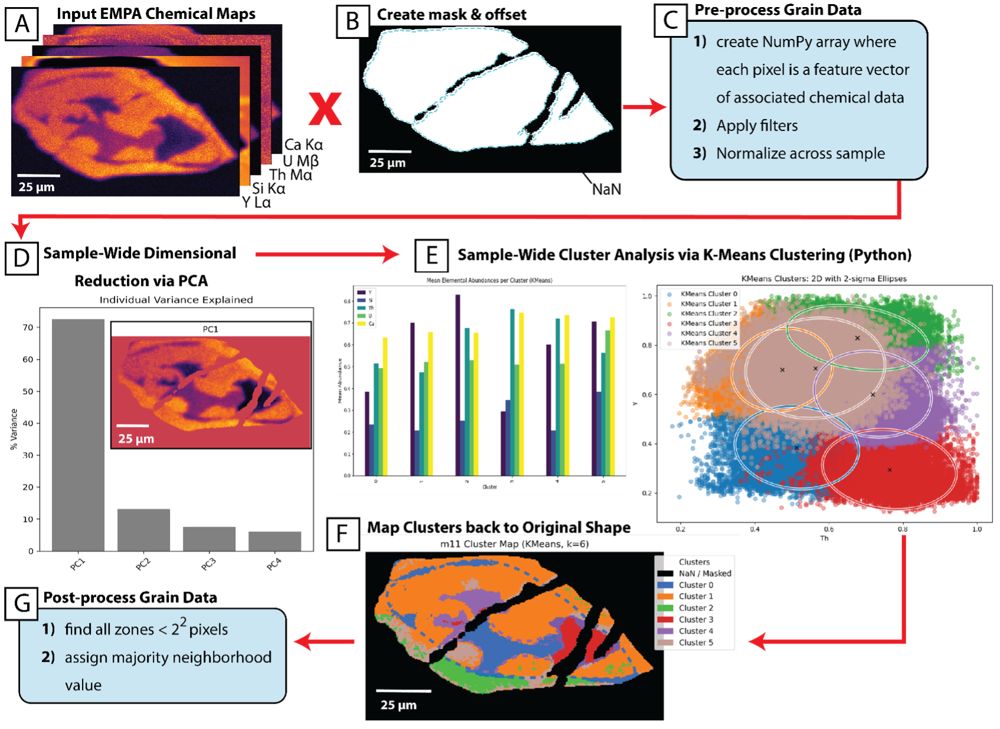

## Hi there 👋

I’m a geoscientist working at the intersection of petrology, geochemistry, tectonics, and machine learning.

I build pipelines that translate high-dimensional, spatially structured Earth data into physically interpretable geological processes.

---

## Selected Projects

---

### RockClock — Geochemical Domain Detection

End-to-end pipeline for transforming EPMA/XRF maps into interpretable chemical domains using:

* filtering + normalization
* PCA
* clustering (KMeans, GMM)

**Focus:** identifying growth histories and chemical structure in polymetamorphic systems

**Key Insight:** This approach enables identification of chemically distinct growth domains that are difficult to resolve through traditional inspection alone.

👉 Repository currently private (happy to discuss!) *

*Note: RockClock is part of ongoing collaborative research, & public-facing version and documentation will be released following publication.*

*Pipeline overview: geochemical maps are converted into pixel-wise feature vectors, reduced using PCA, clustered into chemically distinct groups, and mapped back into spatially coherent domains.*

#### Why RockClock?

Traditional workflows for interpreting geochemical maps often rely on manual inspection and subjective classification.

RockClock provides a reproducible, data-driven alternative that:

* supports reproducible, data-driven domain identification
* preserves spatial context
* captures multi-element chemical relationships
* detects subtle or overprinted domains
  

The goal is not just classification, but **interpretable and reproducible analysis**: linking chemical structure to geological processes such as mineral growth, metamorphism, and melt evolution.

---

### ML Geo Pixel Classification — Mineral Identification

Supervised machine learning workflow for classifying mineral phases from multi-element geochemical maps using pixel-wise feature vectors.

This project serves as a proof-of-concept for translating spatially structured geochemical data into mineral classifications using interpretable models, even in highly deformed and chemically overprinted systems.

**Workflow:**
* manual labeling + feature engineering  
* PCA + exploratory analysis  
* Random Forest classification + grid search  

**Focus:** automating mineral identification and bulk composition extraction from thin section data  

**Key Insight:**  
Pixel-wise geochemical data can be effectively classified using relatively simple, interpretable models, demonstrating that robust mineral identification does not require complex deep learning architectures when domain structure is preserved.

👉 https://github.com/nicole-m-aikin/ML-Geo-Pixel-Poppers

  

*Example output 1: Random Forest classification achieves >96% accuracy for garnet, accurately recovering spatially coherent domains (garnet porphyroblast) directly from pixel-wise geochemical features.*

  

*Example output 2: Random Forest Classification achieves ~80% accuracy for biotite, reflecting greater compositional overlap and complexity, but the model still captures spatially coherent foliation-parallel mineral domains.*

---

**Why this approach?**

* prioritizes interpretability and physical meaning over black-box models  
* leverages spatial + compositional structure inherent in geochemical data  
* performs well on small, domain-specific datasets  
* reduces overfitting by combining dimensionality reduction with constrained model complexity  
* emphasizes reproducibility and transparency in feature construction and classification  

---

## What I care about

* Physically interpretable machine learning
* Spatial + compositional data integration
* Using ML to clarify, not obscure, Earth processes

---

## Background

MS Earth & Space Sciences, University of Washington

NSF Graduate Research Fellow

BS Earth Sciences, University of California, Santa Barbara

*CV available upon request*

---

## Currently Working On

### Legacy Mining + AI — Re-evaluating Historical Geological Data

Exploring how machine learning can be used to re-analyze legacy geological mapping and mineral system data through a modern systems-based framework, with particular attention to initiatives like the USGS Earth MRI program and broader efforts to address critical mineral supply challenges.

Focus areas:

* translating legacy classifications into modern mineral system models
* integrating spatial, temporal, and geochemical datasets
* developing interpretable ML approaches for target generation

This work is informed by ongoing research into critical mineral supply constraints and their implications for supply chain resilience.

Goal: identify overlooked patterns and reduce uncertainty in mineral exploration using existing data.

---

## Contact

LinkedIn: https://www.linkedin.com/in/nicole-m-aikin

